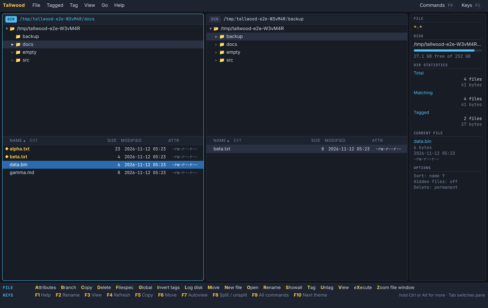
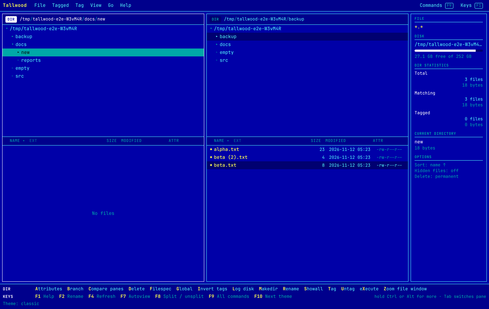
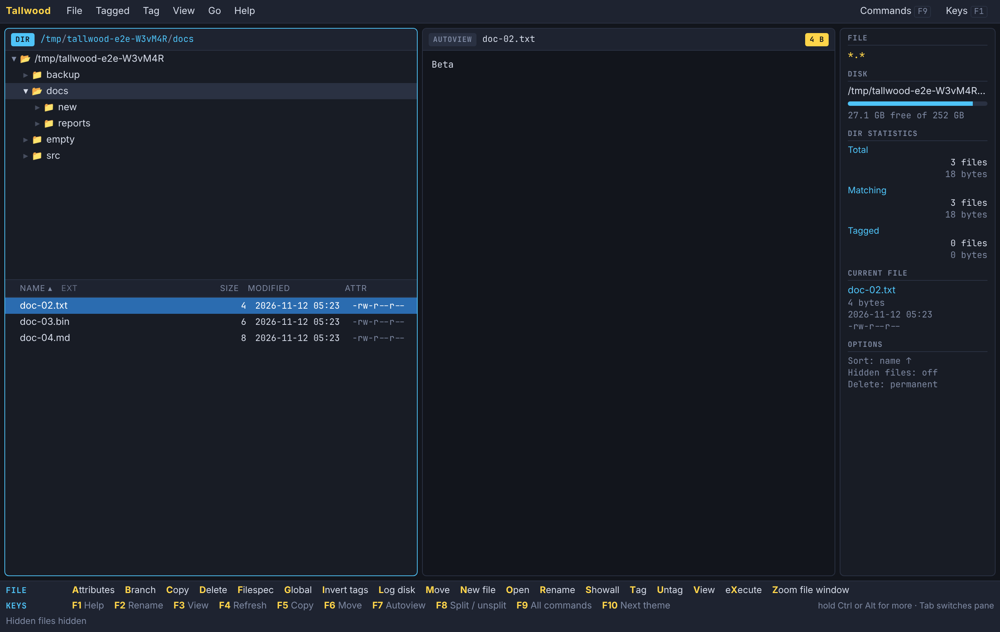

# Tallwood

A two-pane, keyboard-first tree file manager for **Windows and Linux**, built in the spirit of
the DOS-era tree managers: log a disk, walk the tree, tag files, act on the tagged set with one
keystroke. It is a new program with its own code and name, not a port.



## What it does

- **Two panes**, each with a directory tree above a file window. `Tab` switches, `F8` unsplits.
- **Single-letter commands** shown in a command bar that changes as you hold `Ctrl` or `Alt`,
  exactly the way muscle memory expects: `C`opy, `M`ove, `D`elete, `R`ename, `T`ag, `U`ntag,
  `F`ilespec, `L`og, `V`iew, `O`pen, e`X`ecute...
- **Tagging**: `T`/`U`/`Space`, `Ctrl+T` tag all, `I` invert, then `Ctrl+C` / `Ctrl+M` /
  `Ctrl+D` / `Ctrl+R` on the tagged set. `Alt+C` / `Alt+M` copy or move *with paths*.
- **Branch, Showall, Global** (`B`, `S`, `G`): flat views of every file below a folder, in the
  logged root, or across both panes' roots. `Ctrl+S` shows only tagged files.
- **Filespec** with multiple patterns and exclusions: `*.jpg *.png`, `*.rs -*test*`, `invoice`.
- **Statistics panel**: filespec, disk space, total / matching / tagged files and bytes.
- **Compare panes** (`C` in the tree): tag unique, newer, different or identical files.
- **Graft** (`Alt+G`) and copy branch (`Alt+C`) from the tree.

And the things a 2020s file manager should have:

- The other pane is the default destination; conflicts ask once: skip, overwrite or keep both.
- Copies and moves run in the background with progress and cancel; same-volume moves are instant.
- Delete goes to the **trash/recycle bin** (`Shift+Del` or the palette for permanent).
- **Batch rename** with live preview: `*.bak`, `photo-{n:3}.*`, `{date}-{name}.{ext}`.
- **Autoview** (`F7`) previews text, hex and images as you move; `V` opens the full viewer.
- **Command palette** (`F9`), menus, right-click menus, mouse tagging (`Ctrl`/`Shift`+click).
- Virtualised lists: hundreds of thousands of files in Showall stay smooth.
- Three themes (`F10`): Midnight, Classic blue, Paper. Settings and last folders are remembered.

| Classic theme | Autoview |
| --- | --- |
|  |  |

Press `F1` in the app for the full key list.

## Run it

Download a build from the **Tallwood** workflow run on GitHub (Actions tab, artifacts
`tallwood-windows` and `tallwood-linux`), or build it yourself:

```bash
cargo build --release --features custom-protocol
```

The result is one ~5 MB executable: `target/release/tallwood` (`tallwood.exe` on Windows).

- **Windows 10/11**: nothing else to install (uses the built-in WebView2).
- **Linux**: needs WebKitGTK 4.1 at runtime (`sudo apt install libwebkit2gtk-4.1-0`), and
  `libwebkit2gtk-4.1-dev` to build.

```bash
tallwood                 # start in your home folder
tallwood ~/Projects      # log a folder as the root
tallwood --serve 7717    # no window: serve the same UI to a local browser
```

`--serve` listens on 127.0.0.1 only and requires the one-time token in the URL it prints. It is
handy on a headless box over an SSH tunnel; a build made with `--no-default-features` has no GUI
dependencies at all. In a browser, `Ctrl+T` / `Ctrl+N` belong to the browser, so use `Ctrl+A`
(tag all) and the palette there.

## Develop

```bash
cargo test --no-default-features                 # backend unit tests
cargo build --no-default-features && node tests/e2e.cjs   # drives the real UI (needs Playwright)
```

- `src/core.rs` file-system RPC, `src/jobs.rs` copy/move/delete jobs, `src/serve.rs` browser mode.
- `ui/` is plain HTML/CSS/ES modules with no build step.
